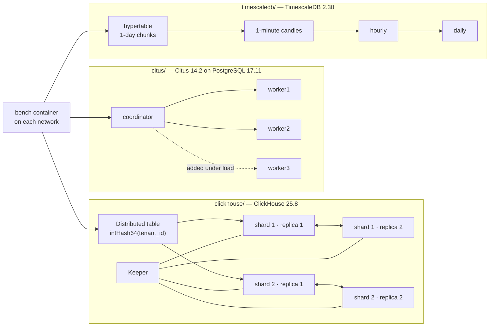

# distributed-db-lab

Scaling PostgreSQL out with Citus, time-series at scale with TimescaleDB, and a replicated ClickHouse cluster — on one laptop, with the failures I hit and the numbers that came off the runs.

[](https://github.com/technobasant/distributed-db-lab/actions/workflows/ci.yml)

Horizontal scale is usually sold as a topology diagram: add nodes, data spreads, queries get faster. What actually decides whether it works is less photogenic — which key every table carries, which constraints have to change before the first table can be distributed, what a rebalance does to the latency of the writes that keep arriving, and what to do about the one customer whose data is seven times the size of everyone else's.

This lab rebuilds, from scratch and on synthetic data, the patterns I worked through on client engagements: a warehouse migrated table by table onto Citus, and an audit of a multi-terabyte TimescaleDB hypertable whose index outweighed its data. No client code, schema or figures are in here — every number below was measured on this rig and is in [MEASUREMENTS.md](MEASUREMENTS.md) with its method and the file it came from.

Citus has been part of my work since 2021; [citusdata/citus#4776](https://github.com/citusdata/citus/issues/4776) is a report of mine from then — adding a constraint without a name to a distributed table failed — which Citus's maintainers fixed by adding unnamed-constraint support in January 2023.

## What it shows

| Part | Claim | Evidence |
|---|---|---|
| [`citus/`](citus) | A single-node schema distributes cleanly only after its keys, constraints and foreign keys are reshaped around the tenant — and a tool can find every change from the catalog | 6 failure classes reproduced with Citus's own errors; the planner's script moves all 10 tables and restores all 11 FKs |
| | Co-location is the performance model | a one-tenant query routes to 1 shard (p50 3.77 ms); the same join is 4× faster co-located than repartitioned |
| | A node can be added under write load without losing anything | 7 shard-group moves in 37.1 s, 977,368 operations, **0 errors**, every acknowledged write present |
| | Size skew needs splitting, not moving | the whale's shard is 7.4× the median; isolating it, then a size-based rebalance with the base cost at 0, takes node sizes from 2.36× apart to 1.10× |
| [`timescaledb/`](timescaledb) | The primary-key order is a trade-off, not a rule | entity-led key: entity queries 2–3× faster, index 1.43× the heap vs 0.91× for time-led |
| | Compression and aggregates are where the big wins are | columnstore **17.0×** smaller and 4.5× faster on entity range scans; daily candles from a continuous aggregate in 0.157 ms vs 15.3 ms |
| | Insert-only tables need vacuum too | a query the index could answer alone read 24,695 heap blocks until VACUUM set the visibility map; then an index-only scan read none, 88 ms → 2.5 ms |
| [`clickhouse/`](clickhouse) | The sort key is the index | one tenant reads 49,152 rows with a tenant-first `ORDER BY` vs 4,168,647 with `ORDER BY (ts)` |
| | Replication survives a node loss without stopping writes | a replica down for 60 s: 40/40 inserts and 30/30 reads succeeded; it caught up 0.8 s after it was serving |
| [`compare/`](compare) | One dataset, four engines, no winner declared | ingest rate, size on disk and four queries, warm and cold |

## Topology



| Component | Version | Notes |
|---|---|---|
| PostgreSQL | 17.11 | Citus and TimescaleDB images |
| Citus | 14.2.0 | built from the `v14.2.0` tag — the published images are amd64-only, and an emulated database would make every timing meaningless on Apple Silicon. CI uses the official image. |
| TimescaleDB | 2.30.2 | Timescale License edition (columnstore and continuous aggregates are not in the Apache-2 build). Multi-node was removed in 2.14, so scale-out here is the Citus part. |
| ClickHouse | 25.8.33.6 LTS | server and Keeper |

## Quick start

Docker with at least 8 CPUs and 12 GB for the VM, [uv](https://docs.astral.sh/uv/), and about 10 GB of disk. Run **one part at a time** and tear it down before the next.

```bash
make setup          # uv venv + dependencies
make data           # ~2.5 GB of seeded CSV under data/ (git-ignored)
make citus          # cluster, naive attempt, plan, migrate, queries, rebalance, skew
make tsdb           # key order, chunks, columnstore, candles, retention, vacuum
make ch             # cluster, load, sort-key variants, rollup, parts, replica outage
make compare        # one dataset in Postgres, Citus columnar, TimescaleDB, ClickHouse
make down           # remove every container and volume
make check          # what CI runs: ruff, tests, shellcheck, compose validation
```

Each part is also a script with one subcommand per step — `citus/scripts/citus.sh plan`, `clickhouse/scripts/ch.sh failover` — and every step writes its evidence under `results/`. The first `make citus` compiles Citus (about six minutes).

## Results

Medians in milliseconds unless stated. Every figure is in [MEASUREMENTS.md](MEASUREMENTS.md) with its method; read the noise caveat there before comparing p95s.

### Citus: migration, routing, rebalance, skew

| | |
|---|---|
| Naive `create_distributed_table` on a normal schema | fails 6 different ways, one at a time ([log](results/citus/naive-attempt.log)) |
| Planner on the live catalog | root `tenants`, 8 distributed + 2 reference tables; 15 issues with the SQL to fix each ([plan](results/citus/plan.sql)) |
| Planned migration, 6M events, 2 workers | **122.3 s**, all FKs restored, 0 NULL tenants |
| One tenant, routed to 1 shard | p50 **3.77**, p99 77.96 |
| All tenants, 32 shards in parallel | p50 677.3 |
| Same join, co-located vs repartitioned | **1,252** vs 5,206 |
| Add worker3 and rebalance under 8-thread load | 37.1 s of moves; read p99 24.7 → 33.6, write p99 38.0 → 54.7; **0 errors**, all 195,543 acknowledged writes present |
| Whale shard vs median shard | 171.7 MB vs 23.1 MB |
| Isolate the whale, rebalance by size (base cost 0) | 12.8 s + 13.9 s; node bytes 358 / 283 / 665 MB → **438 / 456 / 415 MB** |

### TimescaleDB: 20.7M ticks

| | Time-led PK | Entity-led PK |
|---|---|---|
| index ÷ heap after time-ordered ingest | **0.91** | **1.43** |
| one entity, last 6 h | 6.29 | **1.99** |
| one entity, hourly over 2.5 days | 52.1 | **22.5** |
| all entities, last 15 min | 1.32 | 1.28 |

Bolting an entity index onto the time-led key recovers part of the read speed (3.31 / 38.6) and costs another 842 MB of index.

| | |
|---|---|
| Columnstore, segment by entity | 2,785.5 MB → **163.4 MB (17.0×)** in 17.1 s; entity range scan 56.3 → 12.6 |
| Chunk interval 1 h / 1 day / 7 days | 288 / 12 / 3 chunks; planning p50 for a 2.5-day query 1.60 / 0.17 / 0.16 |
| Candles 1 m → 1 h → 1 day | built in 14.0 s; daily candles 0.157 vs 15.3 from raw; verified against raw |
| Retention | 9 of 12 raw chunks dropped in 79 ms; every daily candle kept |
| Insert-only table, before → after VACUUM | 0 → 100% all-visible pages; 24,695 → 0 heap blocks; 88.0 → 2.5 |

### ClickHouse: 2 shards × 2 replicas, 10M events

| | |
|---|---|
| Load through the Distributed table | **853,242 rows/s** |
| One tenant: `ORDER BY (tenant_id, …)` vs `ORDER BY (ts)` | 49,152 vs 4,168,647 rows read; 2.68 vs 16.83 |
| LowCardinality vs String, `country` column | 10.06 vs 15.52 MB; GROUP BY 44.4 vs 64.0 |
| Daily rollup (AggregatingMergeTree), 10.9 : 1 | **slower** than the raw table: 16.8 vs 9.5 |
| 300 small inserts, sync vs async | 300 vs **37** parts written |
| Replica down 60.3 s, then restarted | missed 1,452,437 rows; serving in 3.5 s, caught up 0.8 s later |

### One dataset, four engines

10M rows, loaded in time order, one engine at a time. Warm p50 / cold.

| | PostgreSQL + B-tree | Citus columnar | TimescaleDB columnstore | ClickHouse |
|---|---|---|---|---|
| On disk | 1,157.7 MB | 123.6 MB | 139.5 MB | 122.8 MB |
| Ingest rows/s | 724,638 | 1,149,425 | 331,126 (+20.7 s compress) | 451,764 |
| Q1 count by type, all rows | 652 / 2,545 | 852 / 882 | 212 / 283 | 131 / 146 |
| Q2 one tenant by day | **2.1** / 22 | 344 / 702 | **2.1** / 46 | 6.7 / 147 |
| Q3 top tenants by distinct users, a week | 874 / 1,247 | 255 / 1,177 | 133 / 197 | 53 / 161 |
| Q4 revenue by country, a month | 549 / 2,030 | 224 / 257 | 20 / 133 | 15 / 103 |

Postgres with a B-tree answers the point question as fast as anything here and takes 8–9× the space of the columnar engines, which are within 14% of each other on disk. ClickHouse is fastest on all three scans and the least affected by a cold start. TimescaleDB ties Postgres on the point query and comes within 5 ms of ClickHouse on the month-window scan. Citus columnar saves the space but has no index for the point query (344 ms); Citus gets its scan speed from spreading shards across workers, which this single-node comparison deliberately does not do.

## Decisions

| Decision | Alternative | Why |
|---|---|---|
| Distribute every tenant table by `tenant_id`, co-located with `tenants` | distribute each table by its own id | co-location keeps one tenant's joins and foreign keys on one shard; the per-id layout is the one that needed repartition joins (4× slower here) |
| Small lookup tables as reference tables | distribute them too | a reference table joins locally everywhere; at under 10,000 rows replicating it costs little |
| 32 shards (Citus's default) for 2–3 workers | 8, or 128 | enough shards that a new worker takes a fair share in a rebalance, few enough that a 32-task query stays cheap to plan |
| Rows with no tenant go to a reserved tenant 0, references cleared | a separate local table | keeps one query path; the references had to go because a composite FK cannot hold them |
| Isolate the whale before rebalancing | a smarter rebalance | no move can split one shard; isolation turns one skewed shard into three |
| Citus vs TimescaleDB vs ClickHouse | one engine for everything | Citus when it is an application database that outgrew one node and keeps its transactions and FKs; TimescaleDB when the data is time-series on Postgres and compression plus aggregates carry the load; ClickHouse when the workload is analytical scans and the data can be denormalised |
| Client inside the Docker network | the host | the host path added ~3 ms to a `SELECT 1` median on this machine |

## Failures worth knowing

These cost more time than everything that worked, and none of them came with an obvious error.

- **PostgreSQL 17.11 switched off Citus tenant isolation.** The August 2026 minor releases (14.24, 15.19, 16.15, 17.11, 18.6) only allow logical-decoding output plugins listed in the new `output_plugin_libraries`, which defaults to `pgoutput, test_decoding`. Citus's shard split decodes through `citus`, so `isolate_tenant_to_new_shard` failed with `library "citus" may not be used as an output plugin` ([log](results/citus/isolate-attempt1-output-plugin-blocked.log)). Shard moves were unaffected — they use `pgoutput`. The fix, on every node, is `ALTER SYSTEM SET output_plugin_libraries = pgoutput, test_decoding, citus` — a bare list: quoting the whole value stores it as one name and silently does nothing. Citus 14.2.0 predates the change; [citusdata/citus#8777](https://github.com/citusdata/citus/pull/8777) adds a clear error and the upgrade note.
- **Draining a node and removing it straight away poisoned a later rebalance.** A move off the drained node left a deferred-drop record in `pg_dist_cleanup` for the copy it had just moved away. Removing the node in the same session left that record pointing at a node group that no longer existed. Minutes later, after a new worker had joined, the rebalance moved seven shard groups and then retried the eighth 33 times over 33 minutes — `shard move failed as the orphaned shard public.tenants_102385 leftover from the previous move could not be cleaned up` — because the cleanup could never reach the node ([status](results/citus/rebalance-status.txt)). Deleting the rows whose `node_group_id` matches no node let the move finish in 5.3 s ([repair](results/citus/rebalance-repair.log)). Next time I would run `CALL citus_cleanup_orphaned_resources()` and check `pg_dist_cleanup` is empty before `citus_remove_node` — not tested here.
- **One table without a primary key blocks the online rebalancer for the whole cluster.** A `CREATE TABLE … AS` copy left distributed for a join test stopped `citus_rebalance_start` with `cannot use logical replication to transfer shards of the relation … since it doesn't have a REPLICA IDENTITY or PRIMARY KEY` ([log](results/citus/rebalance-attempt1-no-replica-identity.log)).
- **`by_disk_size` balances by count when shards are small.** It adds a fixed 100 MiB to every shard group's cost (`citus.rebalancer_by_disk_size_base_cost`), so with shards of tens of MB it saw a cluster 2.36× apart as balanced and declined every move. That default exists to stop near-empty shards being shuffled; on this data, setting it to 0 balanced the nodes to 1.10×.
- **Rows with no tenant still pointed at other tenants' rows.** Moving them under a system tenant broke the composite `(tenant_id, user_id)` foreign key on the first migration ([log](results/citus/migrate-attempt1-fk-failure.log)). The planner now clears those references in the same `UPDATE`.
- **No table can be distributed first while foreign keys are in place.** Citus refuses a distributed table that local tables still reference, and refuses a table that references local ones. The planner drops every FK, places every table, then re-adds them with the tenant key.
- **Since ClickHouse 25.7, `INSERT INTO <Distributed> SELECT … FROM <Distributed> LIMIT n` applies the LIMIT per shard.** `parallel_distributed_insert_select` now defaults to 2, so each shard runs the statement locally. My "2,000,000 rows" wrote 3,950,848 ([log](results/clickhouse/failover-attempt1-parallel-insert-select.json)); `system.settings_changes` records the change in 25.7.
- **`async_insert` does nothing for `INSERT … SELECT`.** My first parts test sent the same 300 parts both ways and measured nothing. It applies only when the client sends the data.
- **A rollup at a fine grain can be slower than the table it summarises.** At 10.9 : 1, merging `uniq` states cost more than scanning a well-sorted MergeTree.
- **On time-ordered ingest, the entity-led index is the bigger one.** The time-led B-tree only ever appends; the entity-led one splits pages. The read win is real; so is the size.
- **Packaging.** Citus publishes amd64-only images; Citus columnar has been its own extension (`citus_columnar`) since 11.1; Citus between nodes defaults to `sslmode=require`; the extension must exist on a worker before `citus_add_node`; the Postgres images restart once during first boot, so one healthy probe can land on a server about to go away.

## Limits

- **One laptop, and not a quiet one.** Load average 10–44 during the runs; medians are the figures to trust, small differences are not findings. See MEASUREMENTS.md.
- **Synthetic data.** Seeded and shaped on purpose — Zipf tenants, a 15% whale, time-ordered arrival — but synthetic.
- **Docker networking and one VM.** No real network between nodes, so no partitions, and latency between "nodes" is loopback.
- **One ClickHouse Keeper.** Enough to coordinate replication, not a quorum.
- **Cold is VM-cold.** The VM's page cache is dropped; macOS may still cache the disk image.
- **Citus built from source** for arm64; CI exercises the official amd64 image at tiny scale.
- **Not measured:** PgBouncer in front of the coordinator, network partitions, multi-host latency.
- **Lab credentials only.** Postgres nodes use `lab-dev-only` and trust each other on the compose network; the ClickHouse default user has no password. Never copy the compose files into production.
- **Not a vendor benchmark.** The engines were configured equally, not tuned individually; each would do better with an expert's settings.

## Related

- [db-failover-lab](https://github.com/technobasant/db-failover-lab) — six engines, eight failover scenarios, the same one-laptop rule.
- [postgres-ha-lab](https://github.com/technobasant/postgres-ha-lab) — Patroni, etcd and pgBackRest: failover, replica rebuild and point-in-time restore.
- Writing: [basantbhattarai.com.np/writing](https://basantbhattarai.com.np/writing/)

## Licence

Apache-2.0. See [LICENSE](LICENSE) and [NOTICE](NOTICE).
